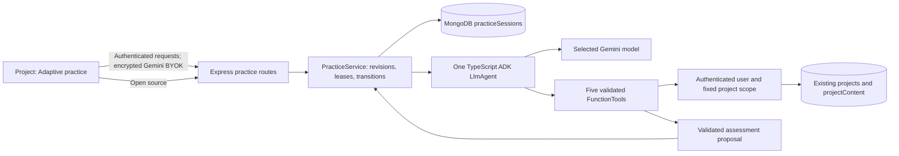

# Adaptive revision practice

Adaptive practice adds a saved tutor session to an existing synced study project. It asks one question at a time, assesses an actual submitted answer using retrieved passages, and uses recent performance to choose the next question. Flashcard correctness counters, difficulty and review ordering remain independent.

## Architecture



The backend uses `@google/adk` 2.3.0. `LlmAgent`, Zod-backed `FunctionTool`, `Gemini`, `InMemoryRunner`, model callbacks and `maxLlmCalls` supply the tool loop and model integration. Explicit per-instance Gemini credentials support concurrent users without changing shared environment variables. No Python service is needed.

ADK sessions are ephemeral for each run. MongoDB stores the authoritative application state, including the current question, topic, evidence IDs and exact quotations, submitted pending answer, completed assessments and revision. Each model invocation receives at most four recent practice summaries. This avoids replaying an unbounded transcript and decouples resumption from SDK session internals.

Official references checked for this implementation:

- [TypeScript quickstart](https://adk.dev/get-started/typescript/)
- [Function tools](https://adk.dev/tools-custom/function-tools/)
- [Models](https://adk.dev/agents/models/)
- [Runtime configuration](https://adk.dev/runtime/runconfig/)
- [Evaluation](https://adk.dev/evaluate/)
- Installed package declarations and implementation are the final API check for the pinned lockfile version. The native TypeScript evaluation implementation supports exact tool trajectories and lexical response matching; lexical overlap does not establish assessment quality.

## Existing architecture and integration choices

| Area | Existing behavior | Tutor integration |
| --- | --- | --- |
| Documents | Browser PDF.js, Mammoth and TXT extraction; combined text uses `--- FILE: name ---`; original uploads use GridFS | Reuse extracted `projectContent.pdfContent`, falling back to original transcript. Never grade generated notes as primary evidence. |
| References | PDF extraction iterates pages but discards page boundaries; no persisted page-reference index | Stable content-addressed passages, labelled with the genuine filename and passage number. No fabricated PDF pages. |
| Review history | Per-card `timesCorrect`, `timesIncorrect`, `difficulty`, `lastSeen` and optional topic label | Aggregate by topic; highest error fraction then difficulty first. Fewer than three historical answers triggers a three-question diagnostic. |
| Spaced revision | Existing difficulty/recency ordering rather than a separate event log | Practice writes only `practiceSessions`; no changes to existing review behavior. |
| AI | Gemini, OpenAI, Anthropic and OpenRouter; browser keys; background jobs encrypt keys using backend RSA-OAEP public key | Reuse encryption helper and backend decryption. Fetch a fresh public key for each tutor turn. Other generation flows remain intact. |
| Ownership | Better Auth middleware and Mongo queries scoped by `userId` | Fixed authenticated scope in every tool; no user/project/database parameters exposed to model. |
| Limits | Subscription tiers cap projects, uploaded files and file size; no existing model-token allowance | Existing project access is required; upload/project limits continue to apply. Additional practice request, session and tool budgets below. |
| Jobs | Mongo-backed background generation worker | Tutor turns run in HTTP requests; persisted leases and answers allow recovery after failures or restart. No new worker or service. |
| Tests | Existing build/typecheck/lint scripts; no server test runner script before this feature | Node test runner with `tsx` import hook; tests use memory persistence and scripted ADK model responses. |

Retrieval uses overlapping 1,600-character passages, a 1,400-character stride, and keyword match ranking. Each search returns at most five snippets; `*` browses the first five when no topic is known. Full passages require a subsequent scoped retrieval. Source IDs include the filename, offset and content hash. Changed material invalidates old links; the source viewer explains this rather than showing an unrelated passage. This is adequate for a first version without a vector database, but synonym-heavy questions and scanned PDFs can fail retrieval.

## Setup and local run

Use the existing MongoDB and Better Auth configuration. Do not point a development test at production data.

1. Install dependencies with `npm ci --prefix server` and `npm ci --prefix web`.
2. Copy `server/.env.example` to `server/.env` if you do not already have local configuration. Supply `MONGODB_URI`, a random `BETTER_AUTH_SECRET`, `BETTER_AUTH_URL=http://localhost:4000` and `FRONTEND_URL=http://localhost:3000`. Leave optional email/OAuth values empty unless configured.
3. Set `ADAPTIVE_PRACTICE_ENABLED=true` in the backend environment. The default is `false`; the project entry point is hidden when disabled. The backend advertises availability, so there is no frontend build-time feature flag.
4. Set `NEXT_PUBLIC_AUTH_URL=http://localhost:4000` in `web/.env.local` and run `npm run dev --prefix server` and `npm run dev --prefix web` in separate terminals.
5. Sign in, open a synced project and select Gemini 2.5 Flash or Pro as the default model in Settings. Add your own Gemini API key. Adaptive practice uses exactly this selection and credential; it never switches provider or uses an operator key.

The first server startup creates these indexes idempotently; no data backfill is needed:

- Unique `(userId, projectId, id)` on `practiceSessions`.
- `(userId, projectId, createdAt desc)` for resumption.
- TTL on `updatedAt`: sessions expire after 90 days of inactivity. MongoDB TTL removal is asynchronous.

Deleting a project also deletes its practice sessions. Existing Dockerfiles remain valid: the SDK is a backend npm dependency and the Node 24 images support it. The checked-in Compose variants pass `ADAPTIVE_PRACTICE_ENABLED`, defaulting to false. Source-based builds are needed to run this branch; published `latest` images do not acquire unshipped code from environment settings.

## Repeatable synthetic demo

This demo uses your selected Gemini key and incurs its normal provider costs; run it only when ready to make model calls.

1. Create a synced project named **Synthetic biology practice**.
2. Upload [`server/eval/biology.txt`](../server/eval/biology.txt). No personal material is needed.
3. Open **Adaptive practice**. With no reviews, select **Start short diagnostic**, or enter `Photosynthesis` as the topic.
4. Answer the single displayed question using the uploaded text. Try a complete answer, an incomplete answer, and an answer that contradicts the source across successive questions.
5. Open a source reference after feedback. It should display the real passage, with no invented page number.
6. Refresh the browser during a saved question and reopen practice. The same question resumes. A failed assessment preserves the submitted answer and offers retry.
7. Continue to the next question and inspect whether it follows up on a gap or moves on after success. End the session to see topics practised and suggested revision. Diagnostics end after three assessments; other sessions end after twelve.

To demonstrate weak-topic selection, first answer existing topic-linked flashcards incorrectly, allow normal project sync to complete, and start another practice session using **Choose from my weak topics**. Unlabelled cards contribute to **General revision**; the application cannot infer fine-grained historical topics that were never recorded.

## Control boundaries and recovery

Tools expose only `get_review_history`, `list_project_topics`, `search_document`, `get_source_passage` and `save_practice_result`. Inputs are strict Zod objects. Outputs are typed, constructed from validated/bounded project data and constrained to the fixed scope. No model tool accepts credentials or identity.

An assessment must cite exact quotations from passages retrieved in the current invocation, and at least one assessment citation must match the question's evidence. A source cannot be retrieved before a search returns its ID. Fabricated IDs, fabricated quotations and unrelated evidence are rejected. Exact quote checks prove source existence; semantic support still needs evaluation and student judgment.

`save_practice_result` stages a validated proposal. Application code commits it only after the run finishes successfully and ownership is checked again. There must be a pending student answer and current question. The application does not save an incorrect result for timeouts, failed tools, missing evidence or abandoned questions. `insufficient_evidence` is an explicit ungraded result, excluded from the summary's assessable denominator.

A compare-and-swap revision and expiring run lease prevent simultaneous writes. Retries of a completed answer return the stored result; a different answer for the same question is rejected. Retrying question generation returns the existing question. Ending a session fences an outstanding model write. A process restart leaves the answer intact; wait for the old lease to expire, refresh and retry. No automatic provider retries spend additional money.

Limits per authenticated user: 30 practice requests per minute and 6 model turns per minute, per backend process. Each session permits 36 attempts and at most 12 assessed questions (3 in a diagnostic). Each run has 6 model calls, 12 tool executions, 1,800 output tokens per model call, a 45,000-character request-content guard, and a 24,000-reported-token guard before another model call. Reported token counts can exceed that guard on the final call. A run has a 45-second application deadline, and individual provider requests have a 25-second timeout. HTTP provider retries are disabled. Distributed deployments should use a shared rate-limit store if global per-user rate limits are required.

## Privacy and operational data

Routine Pino logs retain session/run IDs, tool names, durations, safe failure categories, model latency, reported token counts, retry counts and final run status. They do not contain prompts, passages, answers or keys. ADK default payload logging is disabled. No transcript/debug plugin or trace exporter is enabled. Log retention follows the deployment's existing Pino/container log policy; this feature adds no separate log database.

The authorized application MongoDB collection retains student-visible questions, submitted answers, evidence quotations and assessments for resumption. Unsubmitted drafts use browser session storage scoped to account/project/question and are removed after successful submission. Practice and source-viewer content is marked sensitive and excluded from PostHog autocapture. Model content still goes to the student's chosen provider under that provider's retention policy.

Encrypted API keys exist only in the incoming request; decrypted keys exist only in the per-run model instance. Neither is added to application sessions, ADK session state, MongoDB history or operational logs. RSA encryption supplements HTTPS; deployments must continue using HTTPS.

## Tests and evaluation

Run deterministic checks without model credentials:

```sh
npm test --prefix server
npm run build --prefix server
npm run typecheck --prefix server
npm run typecheck:tests --prefix server
npm run lint --prefix server
npm run lint --prefix web
cd web
npx tsc --noEmit
npm run build
```

The deterministic suite covers ownership denial, missing reviews, empty/failed retrieval, invalid source IDs and quotes, prompt-injection attempts against actual ADK tool schemas, no-answer grading, duplicate submissions, concurrent claims, resumption, timeout recovery, end-session fencing, and model-call limits. It uses the production ADK runner with a scripted model; it does not claim to prove a real model resists every injected instruction. The separate Mongo integration command tests real persistence, Better Auth cookies, cross-user HTTP denial, source routes, flag disabling and project-deletion cleanup against a disposable local database. Browser interaction still needs a local visual smoke test.

Run the integration checks against an isolated MongoDB container:

```sh
docker run -d --rm --name exam-helper-practice-test -p 127.0.0.1:27029:27017 mongo:8
cd server
PRACTICE_TEST_MONGODB_URI=mongodb://127.0.0.1:27029/practice_test_adaptive npm run test:practice:mongo
docker stop exam-helper-practice-test
```

The test accepts only a `practice_test_*` database on that exact local address and drops that disposable database afterward. It explicitly disables external email, OAuth and billing credentials, even if a local `.env` configures them. The existing email client now initializes only when its optional key is configured, so local startup works with email disabled.

The synthetic model evaluation is separate:

```sh
# Requires explicit authorization to spend provider credits. Do not run as a build/test step.
cd server
PRACTICE_EVAL_API_KEY='<your test Gemini key>' npm run eval:practice -- --allow-paid
```

[`cases.json`](../server/eval/cases.json) includes correct, partial, incorrect, ambiguous, missing-fact, empty-source, contradictory-source and injection cases. The harness checks expected verdicts, retrieved evidence before save, bounded tool use and sensible next-action categories. It generates a follow-up question for manual assessment of pedagogical adaptation, prints synthetic-only evidence for reviewing citation support, and runs native ADK `runEvals` with exact tool-trajectory matching on the production agent. That strict trajectory diagnostic may fail for a valid alternative search/order; it is not a grading-quality score. No Python evaluation service is added.

Review the generated explanations and follow-up questions against each fixture's rubric. Quote validation verifies that citations resolve, while this manual rubric review assesses whether the quotations support the feedback. No model-based evaluation scores are reported until the harness is actually run. Native lexical response metrics are intentionally not used as a proxy for correctness.

## Known limits

- Gemini 2.5 Flash/Pro only for adaptive practice. Other providers remain available for existing generation features. Extending the tutor requires validating a provider adapter, BYOK behavior and tool-calling semantics.
- Existing extraction stores no page boundaries. Passage references are genuine; there is no PDF-page navigation or OCR.
- Keyword retrieval can miss synonyms; only the first 500,000 source characters are indexed per run. With no known topic, browsing starts from the first passages.
- Source contradictions and ambiguous questions depend partly on model judgment. Citation checks do not prove semantic entailment.
- Refresh resumes saved server state. There is no push streaming or autonomous background continuation; a retry after a server crash waits for its expired lease.
- Request throttles are process-local. Project/file subscription limits remain unchanged; there is no new paid tutor tier.
- The interface resumes the latest session. It shows completed history for that session; it does not provide an archive browser.
- Live provider, database and Docker/browser checks require the corresponding local services and are reported separately from deterministic tests.

## Verification results (21 October 2026)

| Check actually run | Result |
| --- | --- |
| `npm test --prefix server` | 23 deterministic tests passed; no real model calls |
| Disposable MongoDB + real Better Auth/HTTP integration | 1 integration scenario passed, including concurrent writes, retries, ownership denial, source routes, disabled flag and deletion cleanup |
| Backend build and frontend typecheck | Passed |
| `npm run typecheck:tests --prefix server` | Passed for test, integration and evaluation code |
| Frontend production build | Passed; network access was needed for existing Google Fonts |
| Backend Docker build with Node 24 | Passed |
| Targeted lint on new practice code, tests, eval, integration and client helpers | Passed |
| Full backend lint | Failed on 12 existing errors and 1 warning in existing routes/auth code |
| Full frontend lint | Failed on 19 existing errors and 19 warnings in existing components/pages/store |
| Evaluation authorization guard | Passed: exited 2 without a key/paid-run authorization and made no model calls |
| Live Gemini rubric/trajectory evaluation | Not run; requires credentials and explicit authorization for provider spending |
| Browser visual/interaction smoke test | Not run |

The first HTTP integration attempt inherited local email credentials and attempted verification emails to synthetic `.test` addresses; the provider rejected them. The final passing integration run explicitly disabled external integrations. The test database was disposable and was dropped after each run.
